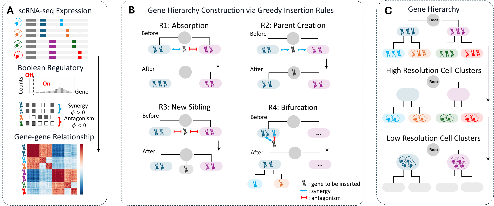
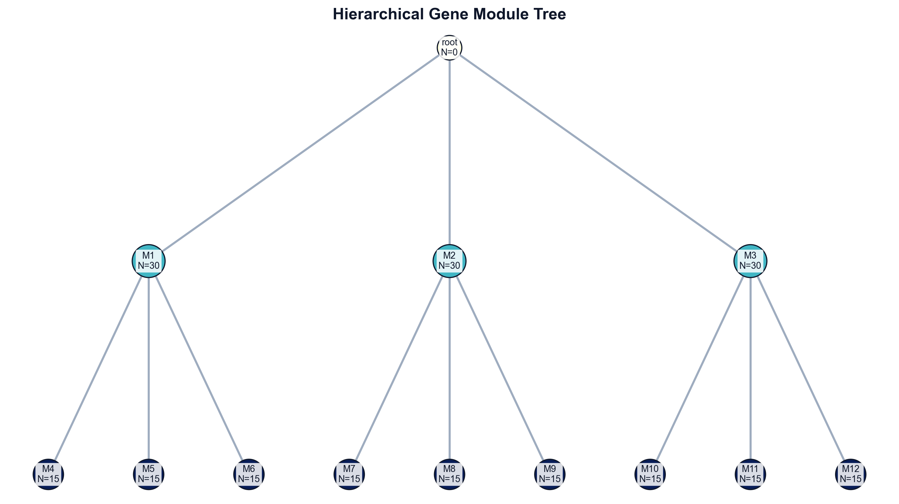
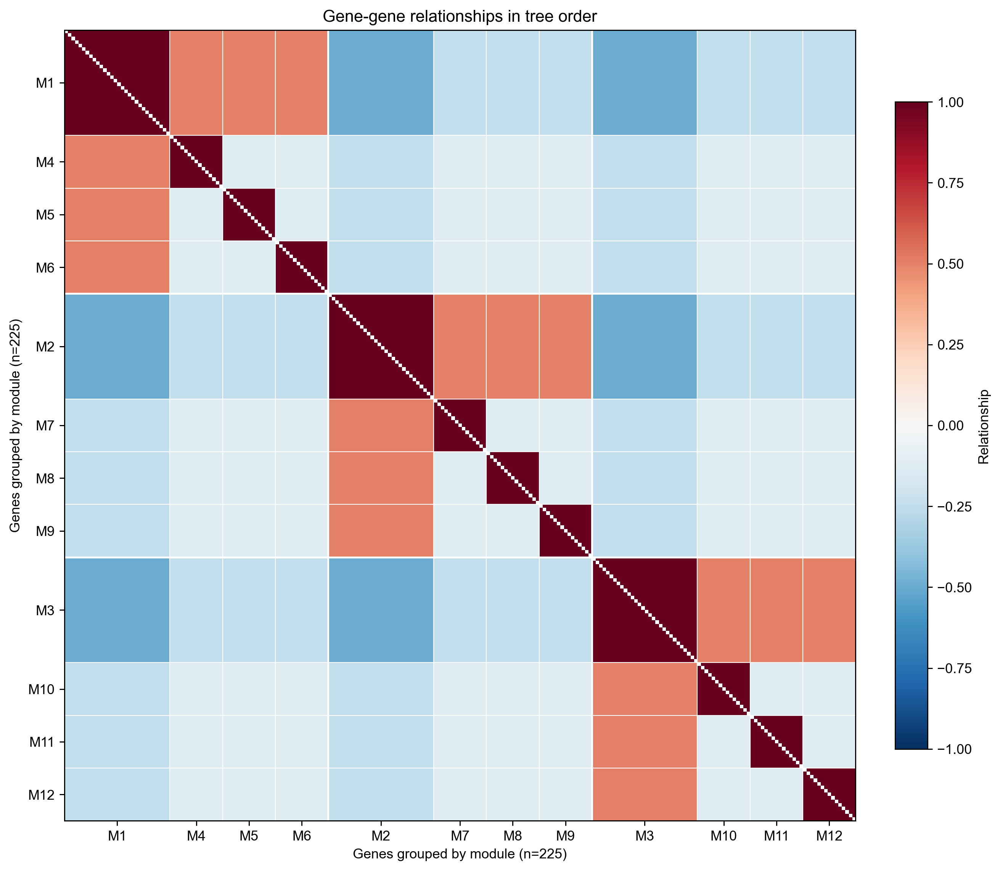

<div align="center">

# GeCCo

**GeCCo (Gene Co-expression Constructed Identity)** is a gene-first framework for constructing interpretable cell identities from single-cell transcriptomic data. It organizes co-expression and mutual exclusion into a hierarchy of gene programs, connecting broad lineages to their finer subtypes. Its central premise is that a credible cell identity rests on genes that support both the proposed grouping and one another. This makes the molecular basis of each distinction explicit, linking the structure of cell identities to the evidence that supports them.

The relevant evidence depends on the comparison. Separating T cells from B cells and resolving naïve from effector T cells ask different questions of the transcriptome. A single global feature space can emphasize broad lineage differences while obscuring the programs that distinguish subtypes.



GeCCo starts with the genes supporting those distinctions. It organizes co-expression and mutual exclusion into a hierarchy, connecting broad lineage programs to more specific subtype programs. Each branch can then be traced to its markers and their pairwise relationships.

The guiding principle is **hierarchical consistency**: a subtype should retain its identity whether analyzed across the full population or within its parent lineage.

## Quick start

Install from the project directory:

```bash
pip install -e .
```

**Load data → build the tree → inspect modules → view gene–gene correlations.**

```python
import anndata as ad
from gecco import GeCCoPipeline
from gecco.visualize import plot_module_tree, plot_relationship_heatmap

adata = ad.read_h5ad("datasets/adata_sim.h5ad")
result = GeCCoPipeline().run(adata)

plot_module_tree(result.tree_root)
print(result.module_table[["node_id", "parent_id", "n_direct", "direct_genes"]])

modules = ["M1", "M2", "M3"]  # Choose module IDs from the tree and table.
plot_relationship_heatmap(result.preprocess, result.tree_root, node_ids=modules)
```

The example uses every gene in the simulation, with no configuration object required. Follow the executed **[simulation tutorial](notebooks/gecco_simulation.ipynb)** to explore the full workflow and individual subtrees.

## Reading the pattern

The matrix reveals the evidence behind each branch. Both axes contain genes, ordered by the tree; each entry is an individual gene-pair correlation. Selecting a parent includes its descendants.

| Relationship | Expected pattern | Interpretation |
|:---|:---:|:---|
| Within a module | Positive | Genes support a shared program. |
| Ancestor to descendant | Positive | Broad markers support the subtypes below them. |
| Across separate branches | Negative | Distinct programs distinguish types or subtypes. |

| Gene module tree | Gene–gene correlation matrix |
|:---:|:---:|
|  |  |
